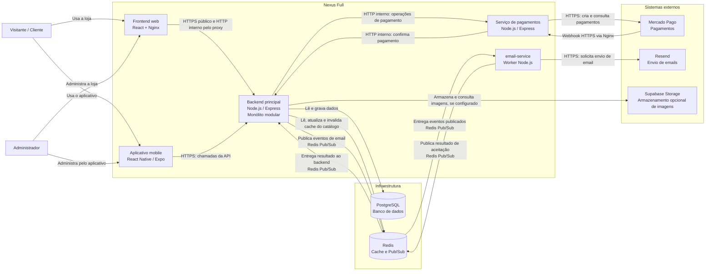

# C4 — Containers

O Nexus Full reúne clientes web e mobile, um backend principal organizado como monólito modular e dois serviços independentes: pagamentos e o worker de notificações. O backend persiste dados no PostgreSQL, usa Redis para cache do catálogo e publica notificações por Redis Pub/Sub. O serviço de pagamentos integra-se ao Mercado Pago por HTTP e o worker solicita o envio de emails ao Resend. Imagens podem ser armazenadas no Supabase Storage quando configurado.

