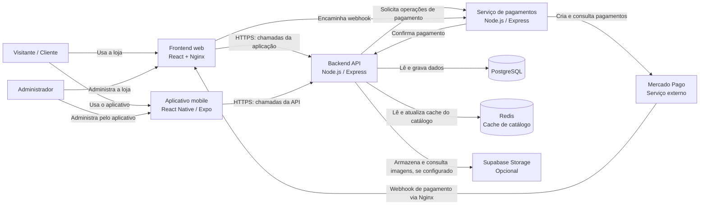

# C4 — Containers

O sistema possui clientes web e mobile que acessam a API do Nexus. O backend usa PostgreSQL para persistência e Redis para cache do catálogo, além de delegar operações de pagamento a um serviço integrado ao Mercado Pago; imagens podem ser armazenadas no Supabase Storage quando configurado.

apenas um teste pra testar a pipeline
