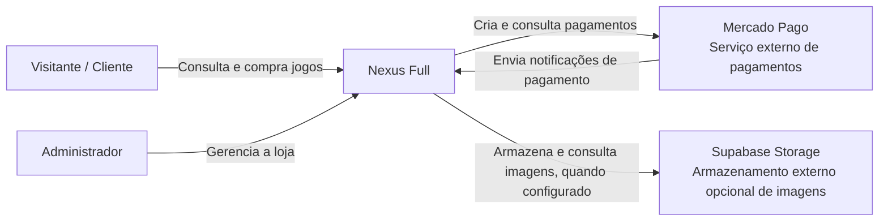

# C4 — Contexto

O Nexus Full é uma loja digital de jogos utilizada por visitantes, clientes e administradores. Para pagamentos, integra-se ao Mercado Pago; o armazenamento de imagens pode usar o Supabase Storage quando essa opção estiver configurada.

