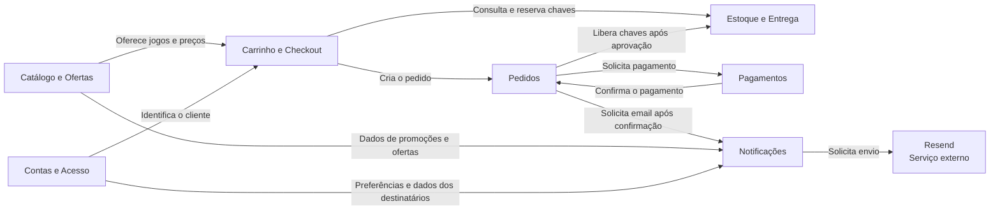

# Modelagem DDD — Nexus Full

## 1. Domínio e subdomínios

O domínio principal do Nexus Full é o **comércio de jogos digitais**: apresentar jogos, vender chaves digitais e entregá-las ao cliente após a confirmação da compra.

Principais subdomínios identificados no projeto:

- Catálogo e ofertas de jogos por plataforma.
- Carrinho, checkout e pedidos.
- Estoque e entrega de chaves digitais.
- Promoções e cálculo de preços.
- Contas, autenticação e permissões.
- Avaliações, votos e lista de desejos.
- Integração de pagamentos.
- Notificações de pedidos e promoções por email.

## 2. Context Map

O mapa abaixo representa conceitualmente as responsabilidades encontradas no projeto. Ele não significa que esses contextos já estejam separados fisicamente no código: grande parte da aplicação compartilha o backend e o banco de dados.

O fluxo de notificações é uma responsabilidade conceitual do domínio. No código, o backend seleciona os destinatários e publica eventos de pedido pago e de promoções. O worker `email-service` compõe e envia os emails pelo Resend. A comunicação entre backend e worker usa Redis Pub/Sub, com um canal de retorno para o resultado de aceitação pelo provedor. Esses processos físicos não definem, por si só, Bounded Contexts separados. O resultado de aceitação do provedor não representa garantia de entrega ao destinatário.

## 3. Bounded Contexts

| Bounded Context | Responsabilidade |
| --- | --- |
| Catálogo e Ofertas | Organizar jogos, plataformas, anúncios, preços e promoções exibidos na loja. |
| Carrinho e Checkout | Manter os itens escolhidos, verificar disponibilidade e iniciar a compra. |
| Pedidos | Registrar a compra, seus itens, valores e situação. |
| Estoque e Entrega | Controlar chaves disponíveis, reservadas ou vendidas e disponibilizar as chaves compradas. |
| Pagamentos | Solicitar e consultar pagamentos no Mercado Pago e encaminhar confirmações ao backend. |
| Contas e Acesso | Manter usuários e controlar autenticação e permissões. |
| Notificações | Selecionar destinatários para eventos de pedidos e promoções e solicitar o envio de emails. É uma responsabilidade conceitual; a publicação é feita pelo backend e o envio pelo worker `email-service`. |

## 4. Elementos DDD — Contexto de Pedidos

| Elemento | Classificação DDD | Situação no projeto |
| --- | --- | --- |
| `Order` | Entity existente; Aggregate Root proposto. | Model Sequelize existente, com identificador, número, valores e situação do pedido. Não é implementado formalmente como Aggregate Root. |
| `OrderItem` | Entity existente; parte do agregado Pedido proposta. | Model Sequelize existente, ligado ao pedido, anúncio, chave e preço do item. |
| `Money` | Value Object proposto. | Não há classe Money. Os valores são guardados como campos numéricos; utilitários fazem arredondamento e cálculo de preços. |

Uma **Entity** tem identidade própria e pode mudar ao longo do tempo. Um **Value Object** representa um valor sem identidade independente, como um valor monetário. Um **Aggregate** agrupa elementos que devem permanecer consistentes; seu Aggregate Root é o ponto de referência para controlar essas mudanças. No código atual, a situação do pedido é um atributo textual (`Order.status`), não um Value Object separado.

Nesta proposta, o agregado **Pedido** é composto pela Entity `Order` e seus `OrderItem`, que ficam sob o Aggregate Root `Order`. Essa é uma sugestão de modelagem para explicar o domínio: os models e services atuais não implementam formalmente essa estrutura DDD, e nenhuma classe ou funcionalidade nova é criada por este documento.
